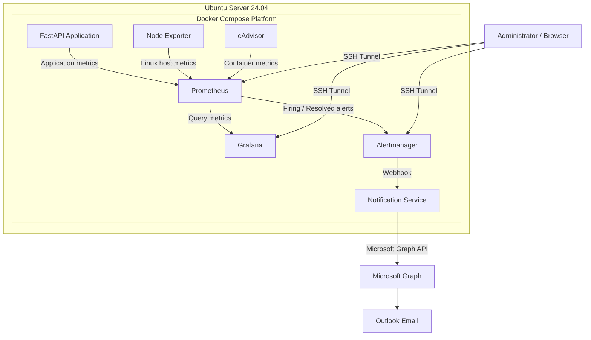
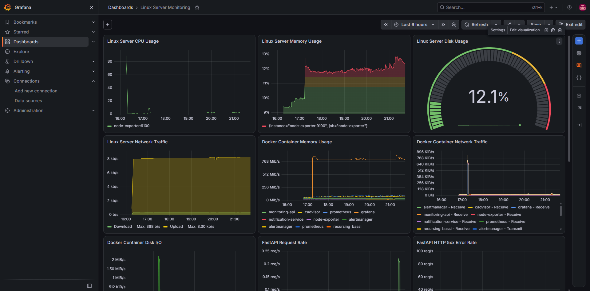
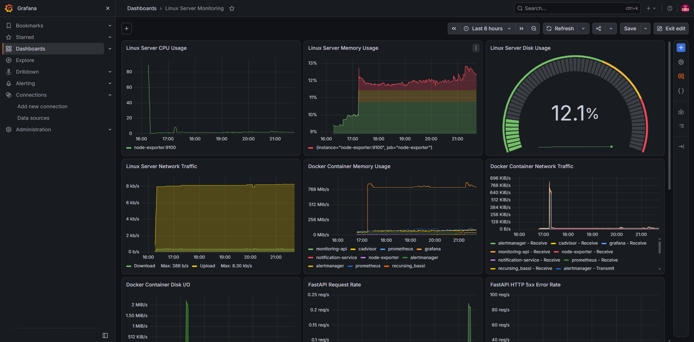
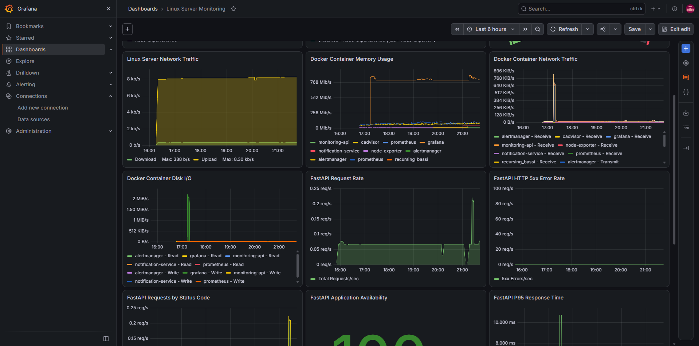
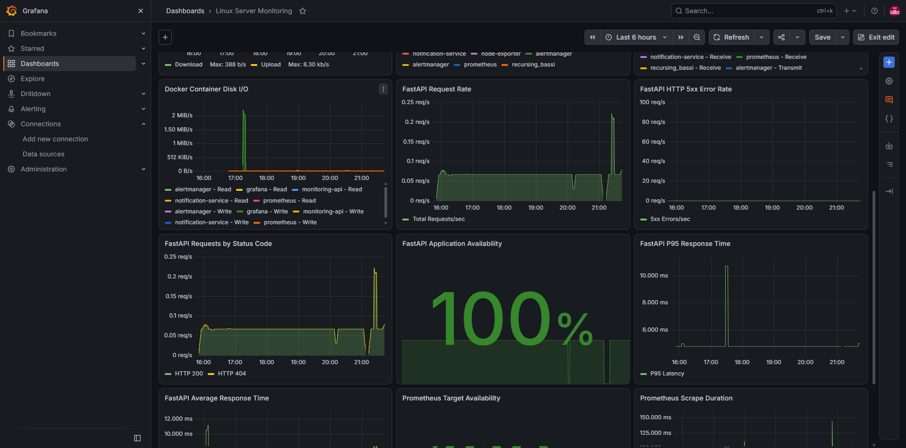
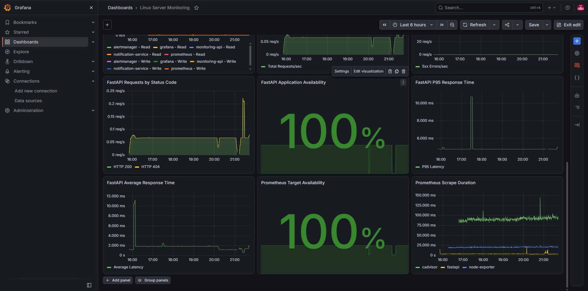
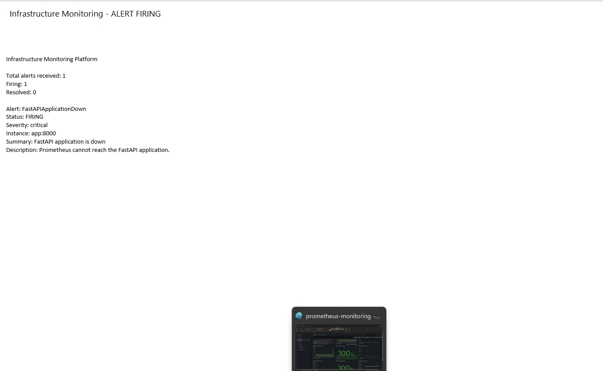
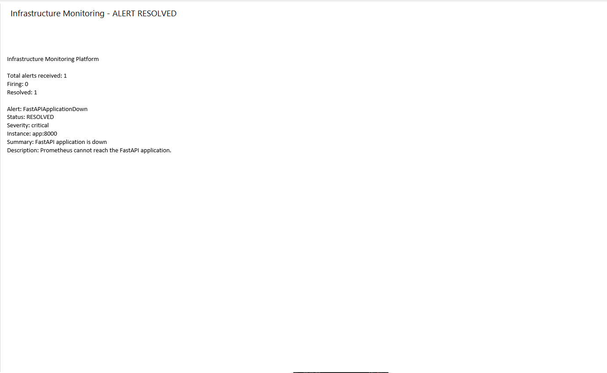

# Infrastructure Monitoring Platform

A containerized infrastructure monitoring and alerting platform built using Docker Compose, FastAPI, Prometheus, Grafana, Node Exporter, cAdvisor, and Alertmanager.

The platform monitors Linux server resources, Docker containers, and application performance. It also provides automated Outlook email notifications through Microsoft Graph.

## Architecture



The platform consists of seven services:

| Service | Purpose |
|---|---|
| FastAPI | Application health and custom metrics |
| Prometheus | Metrics collection and alert evaluation |
| Grafana | Monitoring dashboards and visualization |
| Node Exporter | Linux host metrics |
| cAdvisor | Docker container metrics |
| Alertmanager | Alert routing and notification management |
| Notification Service | Outlook email notifications using Microsoft Graph |

## Features

- Linux CPU, memory, disk, and network monitoring
- Docker container CPU, memory, network, and disk I/O monitoring
- FastAPI application health monitoring
- HTTP request rate and response-time metrics
- Prometheus target availability monitoring
- Custom infrastructure alert rules
- Firing and resolved alert notifications
- Outlook integration through Microsoft Graph
- Persistent Prometheus and Grafana data
- Docker Compose based deployment

## Technology Stack

- Ubuntu Server 24.04 LTS
- Docker Engine
- Docker Compose
- Python 3.12
- FastAPI
- Prometheus
- Grafana
- Node Exporter
- cAdvisor
- Alertmanager
- Microsoft Graph API

## Project Structure

```text
infrastructure-monitoring-platform/
├── alertmanager/
│   └── alertmanager.yml
├── app/
│   ├── Dockerfile
│   ├── main.py
│   └── requirements.txt
├── notification-service/
│   ├── Dockerfile
│   ├── authenticate.py
│   ├── mailer.py
│   ├── main.py
│   ├── send_test.py
│   └── requirements.txt
├── prometheus/
│   ├── alert-rules.yml
│   └── prometheus.yml
├── docs/
│   ├── architecture/
│   └── screenshots/
├── .gitignore
├── docker-compose.yml
└── README.md
```

## Dashboard Screenshots

### Grafana Overview



### Linux Server Monitoring



### Docker Container Monitoring



### FastAPI Application Monitoring



### Prometheus Monitoring



## Outlook Alert Notifications

### Alert Firing Notification



### Alert Resolved Notification



## Deployment

### Requirements

- Ubuntu Server 24.04 LTS or compatible Linux distribution
- Docker Engine
- Docker Compose plugin
- Git

### Clone the repository

```bash
git clone <YOUR-GITHUB-REPOSITORY-URL>
cd infrastructure-monitoring-platform
```

### Start the platform

```bash
docker compose up -d --build
```

### Check service status

```bash
docker compose ps
```

### View service logs

```bash
docker compose logs -f
```

## Accessing the Services

The following interfaces are bound to localhost on the monitoring server:

| Service | Address |
|---|---|
| FastAPI | http://localhost:8000 |
| FastAPI Swagger | http://localhost:8000/docs |
| Prometheus | http://localhost:9090 |
| Grafana | http://localhost:3000 |
| cAdvisor | http://localhost:8080 |
| Alertmanager | http://localhost:9093 |

Use SSH port forwarding to access these interfaces remotely.

Example:

```bash
ssh -L 3000:127.0.0.1:3000 <SSH-HOST>
```

Then open `http://localhost:3000` in your local browser.

## Application Endpoints

| Endpoint | Description |
|---|---|
| `/` | Application information |
| `/health` | Application health check |
| `/api/info` | Application system information |
| `/metrics` | Prometheus metrics |

## Alerting

Prometheus evaluates infrastructure alert rules and forwards firing and resolved alerts to Alertmanager.

Alertmanager sends webhook notifications to the custom notification service, which uses Microsoft Graph to deliver Outlook emails.

The tested alert scenarios include:

- FastAPI application unavailable
- Linux host CPU utilization
- Linux host memory utilization
- Linux root filesystem utilization
- Node Exporter unavailable

## Security

- Monitoring interfaces are bound to localhost.
- Microsoft authentication uses MSAL device-code authentication.
- No Microsoft client secret is required.
- Authentication token cache files must not be committed.
- Environment files, private keys, and credentials are excluded through `.gitignore`.

## Future Enhancements

- Kubernetes deployment using kind
- Kubernetes monitoring with kube-prometheus-stack
- GitHub Actions CI/CD
- Container image vulnerability scanning
- Automated deployment pipeline
- Infrastructure documentation and dashboards

## Project Status

Docker-based monitoring and Outlook alert notification testing completed successfully.

Kubernetes integration and CI/CD are planned for the next development phase.
